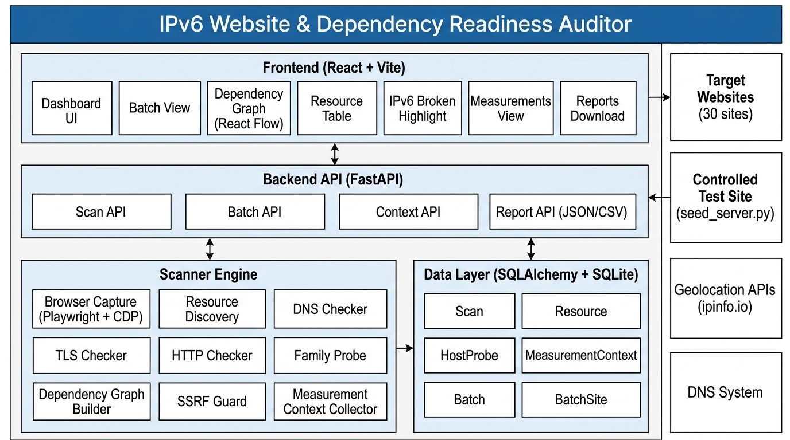
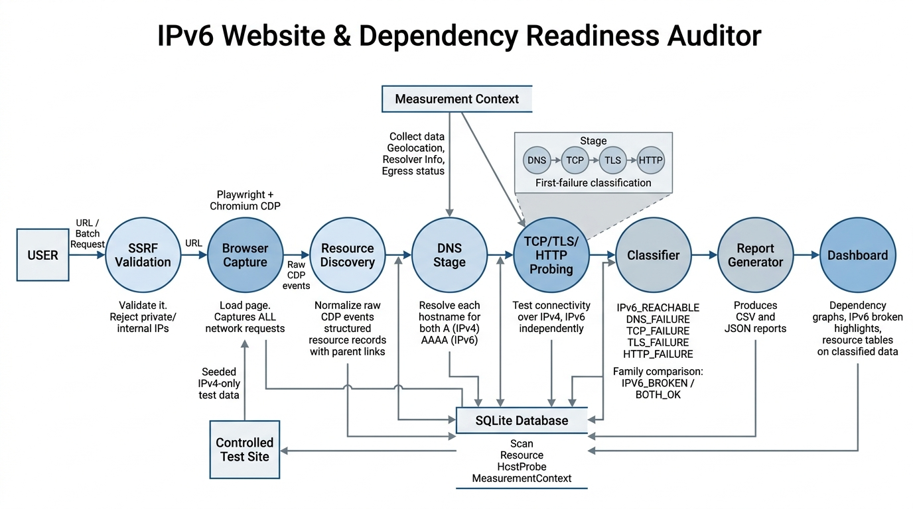

# IPv6 Website & Dependency Readiness Auditor

<div align="center">

[](https://www.python.org/)
[](https://fastapi.tiangolo.com/)
[](https://react.dev/)
[](https://vitejs.dev/)
[](https://playwright.dev/)
[](https://tailwindcss.com/)
[](https://www.postgresql.org/)
[](file:///d:/Full%20Stack%20Projects/A3-PS027-TC039/README.md#testing--quality-assurance)
[](#license--acknowledgments)

**An automated end-to-end diagnostic and auditing platform that uncovers hidden IPv6 breakages across complex web sub-resource dependency trees.**

</div>

---

## Project Information

- **Hackathon**: AIORI-3 (All India Open Research Initiative)
- **Problem Statement**: **PS-027** — *Internet Measurement / IPv6 Readiness Auditor*
- **Team Code**: **A3-PS027-TC039**
- **Lead Developer**: Akshay Kumar ([akshaykumar90537@gmail.com](mailto:akshaykumar90537@gmail.com))

---

## Table of Contents

- [Overview & Problem Statement](#overview--problem-statement)
- [System Architecture](#system-architecture)
  - [Architectural Overview Diagram](#architectural-overview-diagram)
  - [Component Breakdown](#component-breakdown)
- [Data Flow & Probing Pipeline](#data-flow--probing-pipeline)
  - [Data Flow Diagram](#data-flow-diagram)
  - [Stage-by-Stage Lifecycle](#stage-by-stage-lifecycle)
- [Readiness Verdicts & First-Failure Taxonomy](#readiness-verdicts--first-failure-taxonomy)
- [Key Features](#key-features)
- [Controlled Test Bed (Ground-Truth Validation)](#controlled-test-bed-ground-truth-validation)
- [30-Site Benchmark Suite](#30-site-benchmark-suite)
- [Tech Stack](#tech-stack)
- [Directory Structure](#directory-structure)
- [Getting Started](#getting-started)
  - [Prerequisites](#prerequisites)
  - [Quickstart (Unified Launcher)](#quickstart-unified-launcher)
  - [Manual Setup (Backend & Frontend)](#manual-setup-backend--frontend)
- [Configuration & Environment Variables](#configuration--environment-variables)
- [API Reference](#api-reference)
- [Security & SSRF Mitigation](#security--ssrf-mitigation)
- [Testing & Quality Assurance](#testing--quality-assurance)
- [Production Deployment](#production-deployment)
- [License & Acknowledgments](#license--acknowledgments)

---

## Overview & Problem Statement

As global adoption of IPv6 accelerates, many organizations configure `AAAA` records for their apex domains (e.g., `https://example.com`) and assume their web presence is fully IPv6-ready. However, modern web applications rarely rely on a single origin. A single landing page typically fetches dozens of third-party assets—content delivery networks (CDNs), scripts, stylesheets, fonts, tracking pixels, analytics beacons, tag managers, and API endpoints.

If any critical third-party dependency remains **IPv4-only** or suffers from misconfigured IPv6 routing:
1. **Happy Eyeballs Masks Failure**: On dual-stack clients, modern browsers race IPv4 and IPv6 connections (RFC 8305) and quietly fall back to IPv4, leaving site operators completely unaware that their IPv6 infrastructure is broken.
2. **Catastrophic Failure on IPv6-Only Networks**: When accessed by IPv6-only or IPv6-preferring clients (e.g., modern cellular networks, IPv6-only enterprise networks), missing or degraded IPv6 dependencies cause broken styles, hanging scripts, missing authentication tokens, or complete site failure.
3. **DNS Checkers Fall Short**: Existing tools often merely check if the apex domain advertises an `AAAA` record, ignoring dynamically requested assets and failing to inspect actual socket connectivity.

Inspired by the **IETF webres6 initiative** (SAP/webres6), **IPv6 Website & Dependency Readiness Auditor (PS-027)** solves this problem by combining headless browser instrumentation (Playwright + Chrome DevTools Protocol) with independent, per-family dual-stack socket probing (`DNS -> TCP -> TLS -> HTTP`). It reconstructs the complete dependency tree, pinpoints the root cause of IPv6 failures, and provides actionable remediation guidance.

---

## System Architecture

The application is structured into decoupled, resilient tiers designed for high-concurrency probing, modular classification, and clear visualization.

### Architectural Overview Diagram



### Component Breakdown

| Tier | Component | Responsibilities |
|---|---|---|
| **Frontend** | **React 18 + Vite** | High-performance SPA with modern glassmorphic dashboard styling and interactive navigation tabs. |
| | **Dashboard UI** | Central landing view for launching single-URL or multi-site audits with real-time status. |
| | **Batch View** | Multi-site queue management, progress meters, and comparative batch summaries. |
| | **Dependency Graph** | Interactive node-link graph built with **ReactFlow**, visualizing host hierarchies, resource types, and color-coded readiness. |
| | **Resource Table** | Sortable and filterable tabular inspector showing status codes, MIME types, transfer sizes, and timing breakdowns. |
| | **IPv6 Broken Highlight** | Dedicated view isolating high-risk third-party assets that trigger IPv6 failure. |
| | **Measurements View** | Environmental context strip showing scanner egress IP, Geo-IP, DNS resolver status, and local stub identification. |
| | **Reports Download** | One-click export modal generating redacted JSON and tabular CSV reports. |
| **Backend API** | **FastAPI + Uvicorn** | High-throughput asynchronous REST API providing validation, request rate limiting, and route isolation. |
| | **Scan API** | Endpoints for single-site audit queueing, live progress polling, and dependency tree retrieval (`/api/scans`). |
| | **Batch API** | Endpoints for 30-site benchmark suite execution and batch aggregations (`/api/batch`). |
| | **Context API** | Live inspection of scanner vantage point, DNS resolver telemetry, and IPv4/IPv6 egress status (`/api/context`). |
| | **Report API** | Deterministic JSON and CSV generators with automated credential and token redaction (`/api/scans/{id}/report.*`). |
| **Scanner Engine** | **Browser Capture** | Headless Chromium controlled via **Playwright** and Chrome DevTools Protocol (`Network.*` domain) capturing all network requests and initiator stacks. |
| | **Resource Discovery** | Normalizes raw CDP network events into structured records, preserving parent-child dependency edges. |
| | **DNS Checker** | Queries `A` and `AAAA` records concurrently via `dnspython`, resolving CNAME chains and calculating DNS latencies. |
| | **TLS Checker** | Validates dual-stack SSL/TLS certificates, ALPN protocols, cipher suites, and expiry over independent family sockets. |
| | **HTTP Checker** | Performs lightweight HTTP HEAD/GET validation, capturing status lines, redirect locations, and latency metrics. |
| | **Family Probe** | Orchestrates parallel socket connections per host:port across both IPv4 and IPv6 to produce direct comparative metrics. |
| | **Dependency Graph Builder** | Synthesizes resource records and initiator metadata into directed graph structures compatible with ReactFlow. |
| | **SSRF Guard** | Multi-layer firewall blocking loopbacks, RFC 1918/4193 subnets, link-local, NAT64 translations, and DNS rebinding attacks. |
| | **Measurement Context Collector** | Collects public egress IPs, Geo-IP data via `ipinfo.io`, and recursive DNS resolver telemetry. |
| **Data Layer** | **SQLAlchemy 2.0** | Relational ORM backed by PostgreSQL with strict foreign keys, concurrent connection pooling, and ACID transaction isolation. |
| | **Tables** | `Scan`, `Resource`, `HostProbe`, `MeasurementContext`, `Batch`, and `BatchSite`. |
| **External Systems** | **Target Websites** | Arbitrary user-submitted domains and the 30 standard AIORI benchmark websites. |
| | **Controlled Test Site** | Local/public seeded test server (`controlled-site/server/seed_server.py`) serving deterministic failure modes for ground-truth validation. |
| | **Geolocation & DNS** | Public IP information providers (`ipinfo.io`, `ipwho.is`) and upstream authoritative/recursive DNS resolvers. |

---

## Data Flow & Probing Pipeline

Every audit follows a deterministic, 8-phase pipeline ensuring deep protocol coverage and environmental transparency.

### Data Flow Diagram



### Stage-by-Stage Lifecycle

1. **User Request & SSRF Validation**:
   - The user submits a single URL or launches a batch audit via the Web UI or REST API.
   - The **SSRF Guard** intercepts the request, verifies URL structure, enforces port whitelisting (`80`, `443`, `8080`, `8443`), and pre-resolves the target domain. Any request resolving to private, loopback, link-local, or multicast addresses is rejected before any browser or socket is allocated.

2. **Browser Capture (Playwright + Chromium CDP)**:
   - A fresh headless Chromium instance launches in an isolated context with Chrome DevTools Protocol (`CDP`) network instrumentation enabled (`Network.requestWillBeSent`, `Network.responseReceived`, `Network.loadingFailed`).
   - The page loads to network idle, capturing every dynamically injected script, lazy-loaded image, font, stylesheet, and sub-resource.
   - Redirect chains, initiator call stacks, and raw HTTP headers are logged in real-time.

3. **Resource Discovery & Normalization**:
   - Raw CDP events are normalized into persistent resource records with verified MIME types, byte sizes, protocol versions, and explicit parent-child dependency links.

4. **DNS Stage (Dual-Stack Resolution)**:
   - Every unique host discovered during page load is resolved concurrently for both `A` (IPv4) and `AAAA` (IPv6) records using `dnspython`.
   - CNAME chains and resolution latencies are logged. If a host lacks an `AAAA` record, it is immediately marked as missing IPv6 advertising.

5. **Measurement Context Collection**:
   - The scanner collects environment metadata: public IPv4 and IPv6 egress routes, local stub resolver configuration (`/etc/resolv.conf`), recursive resolver egress IP (via Akamai whoami queries), and scanner Geo-IP.

6. **TCP / TLS / HTTP Probing (First-Failure Classification)**:
   - For every discovered host:port, dedicated independent sockets are opened over IPv4 and IPv6.
   - The probe follows a strict 4-stage sequence: **DNS -> TCP -> TLS -> HTTP**.
   - **Socket Integrity**: The TCP connection and subsequent TLS handshake are executed on the **same connected socket** (`asyncio.StreamWriter.start_tls`), ensuring that TLS failures are never conflated with transient TCP connection resets.
   - The probe records the **first failing stage**; subsequent stages are cleanly marked as `NOT_REACHED`.

7. **Verdict Classification & Family Comparison**:
   - Results are synthesized into definitive verdicts (`IPv6_REACHABLE`, `DNS_FAILURE`, `TCP_FAILURE`, `TLS_FAILURE`, `HTTP_FAILURE`).
   - The two protocol paths are directly contrasted to produce a `family_comparison`: `BOTH_OK`, `IPV6_BROKEN`, `IPV4_BROKEN`, `BOTH_BROKEN`, or `INCONCLUSIVE`.

8. **Persistence, Reporting & Interactive Visualization**:
   - All scan artifacts, probes, and metrics are committed to the PostgreSQL database.
   - The **Report Generator** compiles downloadable JSON and CSV reports with sensitive token redaction.
   - The **React Dashboard** renders the interactive ReactFlow dependency graph, broken IPv6 asset callouts, and latency comparison matrices.

---

## Readiness Verdicts & First-Failure Taxonomy

Rather than returning a vague "pass" or "fail", our scanner classifies hosts and resources by their **first failing protocol stage**, matching standard network diagnostic methodology.

### Protocol Verdicts

| Verdict | Trigger Condition | Diagnostic Interpretation | UI Indicator |
|---|---|---|---|
| `IPv6_REACHABLE` | DNS AAAA present, TCP handshake succeeds, TLS verifies, and HTTP responds with valid status. | Host is fully functional over IPv6. | `Green Chip` |
| `DNS_FAILURE` | No `AAAA` record returned (`NO_RECORD`), domain does not exist (`NXDOMAIN`), or DNS query timed out. | Domain owner has not advertised an IPv6 address for this host. | `Red Chip` |
| `TCP_FAILURE` | `AAAA` record exists, but TCP SYN receives `RST` (connection refused) or drops silently (timeout). | IPv6 routing is broken, port is blocked by firewall, or server daemon is not listening on `[::]`. | `Red Chip` |
| `TLS_FAILURE` | TCP connected, but TLS handshake fails (expired certificate, hostname mismatch, untrusted CA, or timeout). | Server serves an invalid or mismatched certificate specifically on its IPv6 interface. | `Red Chip` |
| `HTTP_FAILURE` | TCP & TLS succeed, but server returns an HTTP 5xx Server Error exclusively over the IPv6 path. | Reverse proxy, origin server, or backend application crashes or misroutes traffic over IPv6. | `Red Chip` |
| `BLOCKED` | HTTP returns 401, 403, or 429 (rate-limited / bot-wall / hotlink protection). | Host is reachable, but requires authorization; not counted as an IPv6 protocol failure. | `Amber Chip` |
| `NOT_TESTED` | Scanner lacks IPv6 egress or probe was deliberately bypassed. | Vantage point limitation; scanner avoids reporting false failures when it cannot reach IPv6. | `Gray Chip` |

### Dual-Stack Family Comparison

| Family Verdict | Meaning | Remediation Priority |
|---|---|---|
| `BOTH_OK` | Both IPv4 and IPv6 succeed through all 4 stages. | Healthy |
| `IPV6_BROKEN` | IPv4 succeeds completely, but IPv6 fails at DNS, TCP, TLS, or HTTP. | **Critical Fix Required** |
| `IPV4_BROKEN` | IPv6 succeeds completely, but IPv4 fails (rare edge case). | Medium |
| `BOTH_BROKEN` | Host is completely unreachable or dead across both address families. | Site Error |
| `INCONCLUSIVE` | One family was blocked, timed out, or untested due to local vantage point egress limits. | Review Vantage Point |

---

## Key Features

- **Actual Browser Execution (Not Synthetic Parsing)**: Headless Chromium drives real user browsing scenarios, parsing inline scripts, executing DOM modifications, and intercepting sub-resources that static HTML parsers miss entirely.
- **Hierarchical Causality & Initiator Tracking**: Uses CDP stack traces to identify the exact DOM node or script that initiated a network request, visualizing the full parent-child causality chain.
- **Happy Eyeballs Bypass**: Tests IPv4 and IPv6 independently on separate sockets, exposing hidden breakages that standard browsers conceal through automatic IPv4 fallback.
- **Interactive ReactFlow Dependency Graph**: Dynamic node-link visualization allowing users to zoom, pan, select subtrees, and view dual-stack status chips for every host.
- **30-Site Batch Auditing Engine**: Concurrent multi-target scanning engine with configurable worker limits (`AUDITOR_BATCH_CONCURRENCY`) and database transaction isolation.
- **Privacy-Preserving Audit Reports**: One-click JSON and CSV export featuring automatic sanitization of authorization headers, session cookies, JWTs, and API tokens.
- **Measurement Vantage Point Transparency**: Every audit records local resolver configuration, recursive resolver public egress IP (via Akamai whoami), scanner public IP, and Geo-IP location to guarantee audit reproducibility.
- **Strict SSRF Guard**: Defense-in-depth security layer actively shielding internal infrastructure from SSRF, port scanning, and DNS rebinding vulnerabilities.

---

## Controlled Test Bed (Ground-Truth Validation)

To rigorously validate classifier precision without relying on unstable third-party websites, the repository includes a self-contained **Controlled Test Bed** in [`controlled-site/`](file:///d:/Full%20Stack%20Projects/A3-PS027-TC039/controlled-site/):

```text
controlled-site/
├── content/               # Deterministic test HTML pages and assets
├── server/
│   ├── seed_server.py     # Multi-port server simulating explicit failure stages
│   └── seeded.json        # Manifest of seeded test endpoints
├── tests/
│   └── test_controlled_site.py # Automated end-to-end verification tests
└── README.md              # Detailed documentation of test scenarios
```

### Seeded Failure Scenarios

1. `dual-stack`: Fully compliant IPv4 and IPv6 endpoint (`IPv6_REACHABLE`).
2. `v4only-img`: Serves `A` record only; no `AAAA` record published (`DNS_FAILURE`).
3. `v6-tcp-fail`: Advertises `AAAA`, but IPv6 TCP port drops or rejects connections (`TCP_FAILURE`).
4. `v6-tls-fail`: Advertises `AAAA`, completes TCP handshake, but fails TLS certificate verification (`TLS_FAILURE`).
5. `v6-http-fail`: Advertises `AAAA`, completes TLS, but responds with HTTP 500 Internal Server Error (`HTTP_FAILURE`).

Run automated ground-truth validation:
```bash
python -m pytest controlled-site/tests -q
```

---

## 30-Site Benchmark Suite

The project includes a curated 30-site benchmark suite located in [`backend/sites.json`](file:///d:/Full%20Stack%20Projects/A3-PS027-TC039/backend/sites.json), representing diverse categories across the modern web:

| Category | Representative Websites |
|---|---|
| **Global Tech & Search** | Google, Wikipedia, Cloudflare, GitHub, Mozilla, Microsoft |
| **Global News & Media** | BBC News, The New York Times, Reuters |
| **E-Commerce & Portals** | Amazon, eBay, WordPress.org, Flipkart |
| **Developer Ecosystem** | Stack Overflow, npm, PyPI |
| **CDNs & Infrastructure** | Akamai, Fastly, Netflix |
| **Internet Governance & RIRs** | IETF, ICANN, APNIC, RIPE NCC |
| **Indian Digital Infrastructure** | India.gov.in, IRCTC, NIC India, IIT Bombay, The Hindu, Times of India, LinkedIn |

The batch audit engine processes these sites concurrently, generating comparative readiness ratings and identifying systemic dependency bottlenecks across industries.

---

## Tech Stack

```text
┌────────────────────────────────────────────────────────────────────────┐
│                              FRONTEND                                  │
│   React 18  •  Vite 5.4  •  ReactFlow  •  TailwindCSS  •  Vitest       │
└───────────────────────────────────┬────────────────────────────────────┘
                                    │ REST API
┌───────────────────────────────────▼────────────────────────────────────┐
│                              BACKEND                                   │
│   FastAPI  •  Uvicorn  •  Playwright (Chromium)  •  dnspython          │
│   httpx  •  SQLAlchemy 2.0  •  Pydantic v2  •  pytest / pytest-asyncio │
└───────────────────────────────────┬────────────────────────────────────┘
                                    │
┌───────────────────────────────────▼────────────────────────────────────┐
│                            DATA & STORAGE                              │
│   PostgreSQL (Primary Database)  •  SQLAlchemy 2.0 + psycopg2          │
└────────────────────────────────────────────────────────────────────────┘
```

---

## Directory Structure

```text
A3-PS027-TC039/
├── backend/
│   ├── app/
│   │   ├── api/                     # FastAPI route controllers
│   │   │   ├── batch.py             # Batch scanning endpoints
│   │   │   ├── context.py           # Measurement context endpoints
│   │   │   └── scans.py             # Single-site scan endpoints
│   │   ├── models/                  # SQLAlchemy models & schemas
│   │   │   ├── db.py                # Database session management
│   │   │   └── tables.py            # Relational table definitions
│   │   ├── reports/                 # Exportable reports engine
│   │   │   ├── csv_report.py        # Tabular CSV report generation
│   │   │   ├── json_report.py       # Structured JSON report generation
│   │   │   └── redaction.py         # URL parameter and header sanitizer
│   │   ├── scanner/                 # Core auditing & probing engine
│   │   │   ├── browser.py           # Playwright + CDP lifecycle management
│   │   │   ├── classifier.py        # First-failure verdict classification
│   │   │   ├── context.py           # Vantage point & resolver telemetry
│   │   │   ├── dependency_graph.py  # Hierarchy inference & ReactFlow builder
│   │   │   ├── dns_checker.py       # Asynchronous A and AAAA DNS resolution
│   │   │   ├── family_probe.py      # Independent dual-stack socket orchestrator
│   │   │   ├── http_checker.py      # HTTP HEAD/GET response checker
│   │   │   ├── resource_discovery.py# CDP event normalization
│   │   │   ├── ssrf_guard.py        # IP validation & subnet firewall
│   │   │   ├── tcp_checker.py       # Raw TCP socket handshake verification
│   │   │   └── tls_checker.py       # TLS handshake & certificate validator
│   │   ├── services/                # Background queue & batch worker
│   │   ├── config.py                # Pydantic environment configuration
│   │   ├── main.py                  # FastAPI application entrypoint
│   │   └── middleware.py            # CORS & payload size middleware
│   ├── tests/                       # Pytest test suite (178 backend tests)
│   ├── requirements.txt             # Python dependencies
│   └── sites.json                   # 30-site benchmark target suite
├── frontend/
│   ├── src/
│   │   ├── components/              # Modular UI components
│   │   │   ├── BatchView.jsx        # Batch queue & comparative charts
│   │   │   ├── DependencyGraph.jsx  # Interactive ReactFlow graph
│   │   │   ├── FailuresView.jsx     # Filterable failure stage breakdown
│   │   │   ├── Footer.jsx           # Global footer with legal & info links
│   │   │   ├── IPv4Vs6View.jsx      # Side-by-side family comparison matrix
│   │   │   ├── Ipv6BrokenHighlight.jsx # High-priority IPv6 breakage highlight
│   │   │   ├── MeasurementsView.jsx # Environmental context strip
│   │   │   ├── ResourceTable.jsx    # Complete asset inspector table
│   │   │   ├── StatusBadge.jsx      # Color-coded chips for verdicts
│   │   │   └── Tabs.jsx             # Top-level navigation bar
│   │   ├── pages/                   # Main view pages (Dashboard, PrivacyPolicy, TermsOfUse)
│   │   ├── index.css                # TailwindCSS design system & global styles
│   │   └── main.jsx                 # React root entrypoint
│   ├── package.json                 # Frontend dependencies & scripts
│   └── vite.config.js               # Vite bundler configuration
├── controlled-site/                 # Ground-truth test environment
│   ├── content/                     # Test HTML assets
│   ├── server/seed_server.py        # Synthetic failure injection server
│   └── tests/                       # Ground-truth classifier verification tests
├── deploy/
│   └── DEPLOY.md                    # Dual-stack VPS production deployment guide
├── docs/                            # Documentation, diagrams & architectural records
│   ├── architecture_diagram.jpg     # System Architecture UML diagram
│   ├── data_flow_diagram.jpg        # End-to-end data flow pipeline diagram
│   ├── decisions.md                 # Detailed architectural decision record
│   ├── security-audit.md            # Comprehensive security audit report
│   └── A3-PS027-TC039_Technical_Report.html # Slide presentation & technical report
├── data/                            # Local database cache / schema exports
├── start.py                         # Unified cross-platform runner (FastAPI + Vite)
├── start.sh                         # Linux / macOS shell launcher
├── start.ps1                        # Windows PowerShell launcher
├── start.bat                        # Windows Command Prompt launcher
├── .env                             # Environment variables configuration
└── README.md                        # Master repository documentation
```

---

## Getting Started

### Prerequisites

- **Python**: Version `3.10`, `3.11`, or `3.12`
- **Node.js**: Version `18.x` or later (with `npm`)
- **Git**

### Quickstart (Unified Launcher)

We provide a zero-configuration cross-platform launcher that starts the FastAPI backend (port `8000`) and the React/Vite frontend (port `5173`), handles port cleanup, streams unified logs, and shuts down gracefully on `Ctrl+C`:

```bash
# Using Python (Cross-Platform):
python start.py

# Or on Linux / macOS:
./start.sh

# Or on Windows PowerShell:
.\start.ps1

# Or on Windows Command Prompt:
start.bat
```

Once running, access:
- **Auditor Dashboard UI**: [http://localhost:5173](http://localhost:5173)
- **Interactive Swagger API Docs**: [http://localhost:8000/docs](http://localhost:8000/docs)
- **ReDoc API Documentation**: [http://localhost:8000/redoc](http://localhost:8000/redoc)

### Manual Setup (Backend & Frontend)

If you prefer running services in separate terminals:

#### 1. Backend Setup

```bash
cd backend

# Create and activate virtual environment
python -m venv venv

# Linux / macOS:
source venv/bin/activate
# Windows (CMD):
venv\Scripts\activate.bat
# Windows (PowerShell):
.\venv\Scripts\Activate.ps1

# Install dependencies & Playwright Chromium binary
pip install -r requirements.txt
playwright install chromium

# Launch FastAPI development server
uvicorn app.main:app --host 0.0.0.0 --port 8000 --reload
```

#### 2. Frontend Setup

```bash
cd frontend

# Install dependencies
npm install

# Launch Vite development server
npm run dev
```

---

## Configuration & Environment Variables

Settings are managed via Pydantic settings in `backend/app/config.py` and can be customized in the root `.env` file:

| Variable | Default Value | Description |
|---|---|---|
| `AUDITOR_DB_URL` | `postgresql+psycopg2://...` | SQLAlchemy database URI for PostgreSQL (e.g., `postgresql+psycopg2://postgres@127.0.0.1:5432/auditor_db`). |
| `AUDITOR_MAX_RESOURCES` | `400` | Maximum network resources captured per scan. |
| `AUDITOR_PAGE_TIMEOUT_MS` | `30000` | Playwright browser page navigation timeout (ms). |
| `AUDITOR_IDLE_TIMEOUT_MS` | `8000` | Network idle wait timeout after page load (ms). |
| `AUDITOR_SCAN_DEADLINE_S` | `90` | Maximum overall runtime for a single-target scan (seconds). |
| `AUDITOR_MAX_CONCURRENT_SCANS` | `2` | Maximum concurrent single-URL audits. |
| `AUDITOR_PROBE_CONCURRENCY` | `10` | Worker pool size for concurrent TCP/TLS/HTTP host probes. |
| `AUDITOR_BATCH_CONCURRENCY` | `3` | Number of simultaneous site scans during batch runs. |
| `AUDITOR_ALLOWED_PORTS` | `80,443,8080,8443` | Outbound ports permitted by the SSRF firewall. |
| `AUDITOR_SSRF_ALLOW_HOSTS` | `""` | Comma-separated hosts exempt from private IP checks (for testing). |
| `AUDITOR_CONTEXT_TTL_S` | `300` | Cache time-to-live for vantage point and Geo-IP telemetry (seconds). |
| `CORS_ORIGINS` | `http://localhost:5173,...` | Allowed CORS origins for the REST API. |

---

## API Reference

### Scan Operations (`/api/scans`)

| Method | Endpoint | Description |
|---|---|---|
| `POST` | `/api/scans` | Enqueue a new scan for a target URL. Body: `{"url": "https://example.com"}`. |
| `GET` | `/api/scans` | List recent scans with status and readiness summaries. |
| `GET` | `/api/scans/{scan_id}` | Retrieve comprehensive scan details, resource lists, and failure breakdowns. |
| `GET` | `/api/scans/{scan_id}/graph` | Retrieve ReactFlow-compatible nodes and edges representing the dependency tree. |
| `GET` | `/api/scans/{scan_id}/report.json` | Download structured JSON audit report (`?redact=true` for token sanitization). |
| `GET` | `/api/scans/{scan_id}/report.csv` | Download tabular CSV report of all discovered assets. |

### Batch Operations (`/api/batch`)

| Method | Endpoint | Description |
|---|---|---|
| `POST` | `/api/batch` | Launch a batch audit against the default 30 benchmark sites or custom URL list. |
| `GET` | `/api/batch` | List all previous batch runs. |
| `GET` | `/api/batch/{batch_id}` | Retrieve real-time progress, site-by-site status, and aggregate statistics. |

### Vantage Point & System Health (`/api`)

| Method | Endpoint | Description |
|---|---|---|
| `GET` | `/api/context` | Inspect scanner vantage point context (public IPv4/IPv6, resolver telemetry, Geo-IP). |
| `GET` | `/api/health` | Health check returning status and current scanner version. |

---

## Security & SSRF Mitigation

Because the auditor performs automated browser navigation and socket connections to user-submitted web addresses, security is enforced across five distinct layers (`backend/app/scanner/ssrf_guard.py`):

1. **Strict Subnet & Address Range Filtering**:
   - Blocks Loopback addresses (`127.0.0.0/8`, `::1`).
   - Blocks RFC 1918 Private IPv4 networks (`10.0.0.0/8`, `172.16.0.0/12`, `192.168.0.0/16`).
   - Blocks RFC 4193 Unique Local IPv6 Addresses (`fc00::/7`) and Link-Local networks (`169.254.0.0/16`, `fe80::/10`).
   - Blocks Carrier-Grade NAT (`100.64.0.0/10`), broadcast, and multicast ranges.
   - Unwraps and blocks IPv4-mapped IPv6 (`::ffff:0:0/96`), 6to4 (`2002::/16`), and NAT64 prefixes (`64:ff9b::/96`) to prevent address smuggling.
2. **DNS Rebinding Protection**:
   - Hostnames are resolved through a dedicated resolver and checked immediately before connection. Socket probes bind directly to the verified IP address rather than re-resolving the hostname, preventing TOCTOU DNS rebinding exploits.
3. **Strict Port Whitelisting**:
   - Outbound connections are restricted to standard web traffic ports (`80`, `443`, `8080`, `8443`), preventing attackers from abusing the auditor as an internal port scanner.
4. **Denial-of-Service (DoS) Throttling**:
   - Request bodies are strictly capped at 1 MiB via `MaxBodySizeMiddleware`.
   - Browser navigation has strict hard timeouts (`AUDITOR_PAGE_TIMEOUT_MS`), network idle timeouts, and an overarching scan deadline (`AUDITOR_SCAN_DEADLINE_S`).
5. **Sensitive Parameter & Token Redaction**:
   - Exported reports automatically mask authorization headers, cookies, API tokens, JWTs, and sensitive query parameters (`key`, `token`, `secret`, `auth`, `password`).

---

## Testing & Quality Assurance

The codebase features an exhaustive, automated test suite comprising **220 passing tests**:

```text
============================= TEST SUITE SUMMARY =============================
  • Backend Tests (pytest)            : 178 passing
  • Controlled Site Tests (pytest)    :   6 passing (ground-truth validation)
  • Frontend Unit & UI Tests (Vitest) :  35 passing
  • End-to-End Browser Integration    :   1 passing
  -----------------------------------------------------------------------------
  • Total Automated Tests             : 220 passing (100% pass rate)
==============================================================================
```

### Running the Test Suites

#### 1. Backend Test Suite
Tests SSRF guards, DNS checkers, protocol probes, classification logic, report generators, and API endpoints:
```bash
pytest backend/tests
```

#### 2. Controlled Ground-Truth Verification
Verifies classifier accuracy against synthetic IPv6 failure scenarios:
```bash
python -m pytest controlled-site/tests -q
```

#### 3. Frontend Unit & UI Test Suite
Tests React components, graph visualizers, status chips, and tab transitions:
```bash
cd frontend
npm test
```

---

## Production Deployment

The auditor is built for deployment on dual-stack cloud servers (e.g., Ubuntu 22.04 LTS on AWS, DigitalOcean, or Linode):

1. **System Requirements**: Dual-stack network interface with routable public IPv4 and IPv6 addresses.
2. **Reverse Proxy (Nginx / Caddy)**: Forward API requests (`/api/*`) to FastAPI (`http://127.0.0.1:8000`) and serve the compiled static frontend (`frontend/dist/`).
3. **Database**: High-throughput PostgreSQL database with dedicated connection pooling for concurrent batch audits across all workers.
4. **Dedicated Guide**: See [`deploy/DEPLOY.md`](file:///d:/Full%20Stack%20Projects/A3-PS027-TC039/deploy/DEPLOY.md) for full systemd service configurations, Nginx reverse proxy blocks, and egress firewall rules.

---

## License & Acknowledgments

This project was developed for the **AIORI-3 Hackathon** under **Problem Statement PS-027** (*Internet Measurement Track*).

- Inspired by the **IETF webres6 initiative** ([SAP/webres6](https://github.com/SAP/webres6)).
- Real-browser network instrumentation powered by [Playwright](https://playwright.dev/) and the [Chrome DevTools Protocol](https://chromedevtools.github.io/devtools-protocol/).
- Interactive dependency visualization powered by [ReactFlow](https://reactflow.dev/).
- Dual-stack socket probing built on Python's native `asyncio`, `socket`, `ssl`, and [dnspython](https://www.dnspython.org/).
